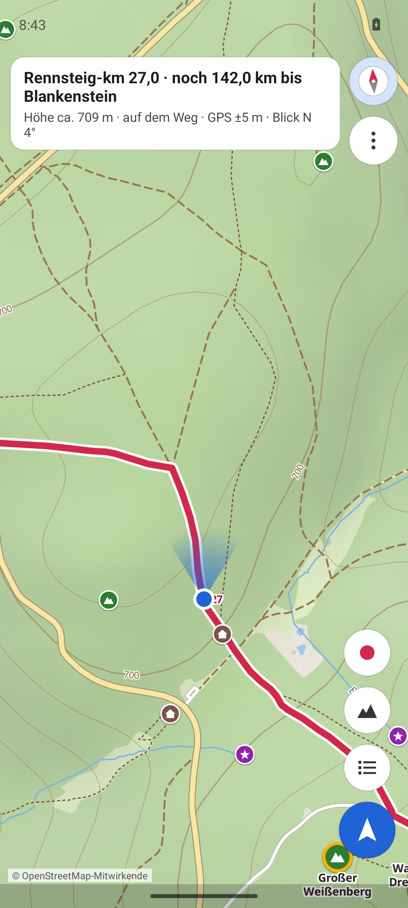
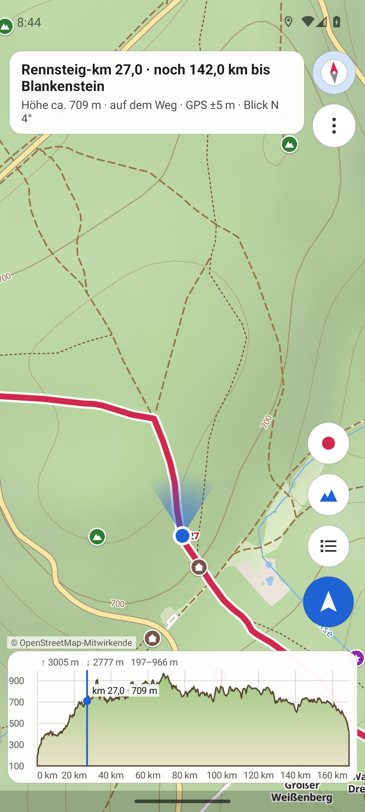
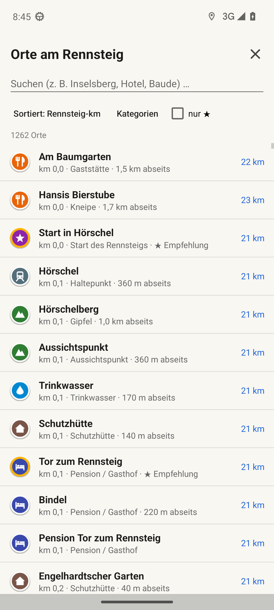
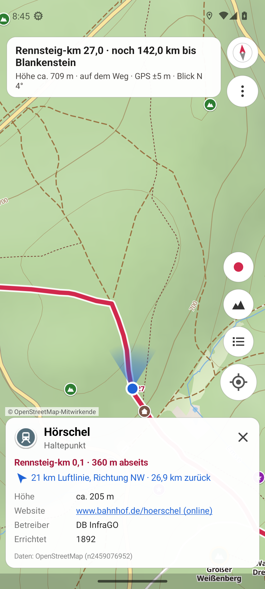
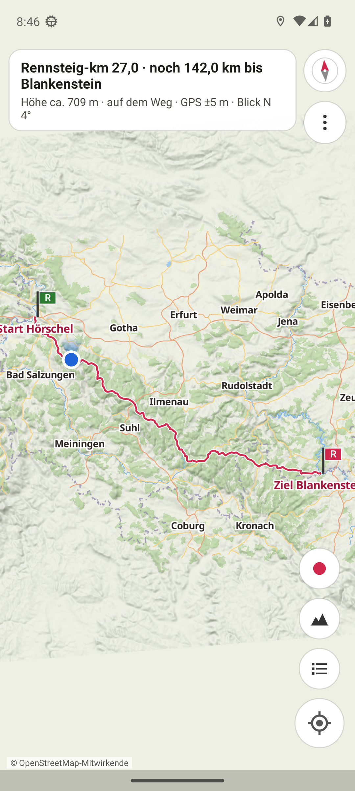

# Rennsteig Offline

Android-App für die Wanderung auf dem **Rennsteig** (Hörschel → Blankenstein, ca. 170 km).
Karte, Route, Orte, Höhenprofil, GPS und Kompass funktionieren **komplett ohne Internet**.

## Funktionen

- **Exakte Route** des Rennsteigs aus OpenStreetMap, mit km-Markierungen und Start/Ziel
- **Offline-Vektorkarte** eines ca. 20 km breiten Korridors entlang des Weges (Wald, Wege, Pfade,
  Orte, Gipfel mit Höhenangabe) plus **Geländeschummerung** und **Höhenlinien** (20 m) aus einem Höhenmodell
- **GPS-Standort** mit Genauigkeitskreis – GPS braucht kein Internet
- **Blickrichtung**: Sichtkegel zeigt, wohin du schaust (Kompass, Deklination wird automatisch
  korrigiert; flach gehalten zählt die Oberkante, aufrecht gehalten die Rückseite des Handys)
- **Automatisches Einnorden**: die Karte dreht sich mit deiner Blickrichtung (Knopf ◎ bzw. Kompass)
- **Orte entlang des Weges**: Unterkünfte, Essen & Trinken, Sehenswürdigkeiten, Aussicht & Gipfel,
  Schutzhütten, Trinkwasser, Bahnhöfe – mit Details (Öffnungszeiten, Telefon, Website, Adresse,
  Sterne, Küche, Höhe), Rennsteig-km und Abstand zum Weg
- **Empfehlungen (★)**: kuratierte Höhepunkte und je 15-km-Abschnitt die bestbewerteten Orte
  (siehe unten)
- **Liste & Suche** aller Orte, sortiert nach Rennsteig-km oder Entfernung
- **Status**: aktueller Rennsteig-km, verbleibende Strecke, Höhe, Abstand zum Weg, Blickrichtung
- **Höhenprofil** der gesamten Route mit eigener Position
- **Wegaufzeichnung** im Hintergrund (auch bei ausgeschaltetem Bildschirm)

## Bildschirmfotos

Automatisch im Android-Emulator aufgenommen (Testposition bei Rennsteig-km 27 am Großen Weißenberg):

| Einnorden & Sichtkegel | Höhenprofil | Orte entlang des Weges | Details zu einem Ort | Gesamte Route |
| --- | --- | --- | --- | --- |
|  |  |  |  |  |

## Bedienung

- **◎ / ➤ (unten rechts)**: Standort folgen → Einnorden (Karte dreht sich mit der Blickrichtung) → Norden oben
- **Kompass (oben rechts)**: zeigt die Kartenausrichtung; antippen schaltet zwischen Einnorden und Norden oben
- **Karte verschieben** beendet das Folgen, **Zoomen** nicht
- **Symbol antippen**: Details mit Rennsteig-km, Entfernung und Richtung (Pfeil zeigt auf dem Bildschirm zum Ort)
- **Liste**: alle Orte, sortiert nach km oder Nähe, mit Suche; **⋮**: Kategorien, nur Empfehlungen,
  Gehrichtung, Bildschirm anlassen, ganze Route
- **●**: Wegaufzeichnung starten/stoppen (läuft auch bei ausgeschaltetem Bildschirm)

## Installation

1. Die APK aufs Handy laden: aus den [Releases](../../releases), direkt aus
   [`dist/RennsteigOffline.apk`](dist/RennsteigOffline.apk) oder als Artefakt des letzten Workflow-Laufs.
2. Öffnen und die Installation aus dieser Quelle einmalig erlauben.
3. Beim ersten Start wird die Offline-Karte eingerichtet (wenige Sekunden), danach Standort freigeben.

Android 6.0 oder neuer.

## Wie werden die „besten“ Orte bestimmt?

OpenStreetMap enthält keine Bewertungen. Mit ★ markiert werden deshalb

- **kuratierte Höhepunkte** (z. B. Großer Inselsberg, Großer Beerberg, Schneekopf, Wartburg,
  Drachenschlucht, Rennsteigwarte, Dreiherrenstein …), siehe [`pipeline/highlights.json`](pipeline/highlights.json);
- je **15-km-Abschnitt** die zwei Unterkünfte, Gaststätten, Sehenswürdigkeiten und Aussichtspunkte
  mit der höchsten Punktzahl. Punkte gibt es für Art (Hotel, Baude, Aussichtsturm …), Wikipedia-Eintrag,
  Website, Telefon, Öffnungszeiten, Sterne und vor allem für die **Nähe zum Rennsteig**.

## Projektaufbau

| Pfad | Inhalt |
| --- | --- |
| `app/` | Android-App (Kotlin, MapLibre Native, ohne Google-Dienste) |
| `app/src/main/assets/style/rennsteig.json` | Kartenstil (OpenMapTiles-Schema) |
| `app/src/main/assets/data/` | Route, Orte und Höhenprofil (von der CI erzeugt) |
| `pipeline/` | Datenaufbereitung: OSM-Extrakt → Route/POIs, Höhenmodell, Vektorkacheln |
| `.github/workflows/build.yml` | Baut Daten und APK, testet im Emulator, veröffentlicht Releases |

### Daten neu erzeugen

Über **Actions → „APK bauen“ → Run workflow** mit „OSM- und Kartendaten neu erzeugen“ werden Route,
Orte und Karte aus dem aktuellen OpenStreetMap-Stand neu gebaut; mit „GitHub-Release veröffentlichen“
entsteht gleich ein neues Release. Ein Commit mit `[release]` (und optional `[apk]`) im Text tut dasselbe.

Der Workflow **„APK bauen“** lädt die Geofabrik-Extrakte (Thüringen, Oberfranken, Hessen), sucht die
Rennsteig-Relation, setzt die Route zusammen, wählt die Orte im Korridor aus, rechnet das Höhenprofil,
erzeugt mit [planetiler](https://github.com/onthegomap/planetiler) die Vektorkarte und baut die APK.
Lokal geht das mit:

```bash
pip install -r pipeline/requirements.txt   # zusätzlich: osmium-tool, Java 21
bash pipeline/build_data.sh                # Ergebnis in build/out
mkdir -p app/src/main/assets/tiles && cp build/out/*.mbtiles app/src/main/assets/tiles/
./gradlew assembleRelease
```

### Signatur

Die APK wird mit dem Projektschlüssel `keystore/rennsteig-offline.jks` signiert, damit sich neue
Versionen über alte installieren lassen. Ein eigener Schlüssel kann über die Umgebungsvariablen
`SIGNING_KEYSTORE`, `SIGNING_STORE_PASSWORD`, `SIGNING_KEY_ALIAS`, `SIGNING_KEY_PASSWORD` gesetzt werden.

## Datenquellen & Lizenzen

- Kartendaten, Route und Orte: © [OpenStreetMap](https://www.openstreetmap.org/copyright)-Mitwirkende, ODbL
- Kartenschema: [OpenMapTiles](https://openmaptiles.org/)
- Höhendaten: [Mapzen Terrain Tiles](https://registry.opendata.aws/terrain-tiles/) (SRTM, EU-DEM/Copernicus u. a.)
- Schrift: Noto Sans (SIL Open Font License)
- Kartenbibliothek: [MapLibre Native](https://github.com/maplibre/maplibre-native) (BSD)

Gut Runst!
